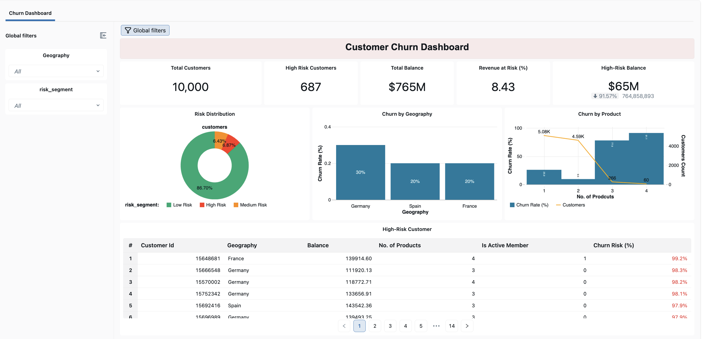
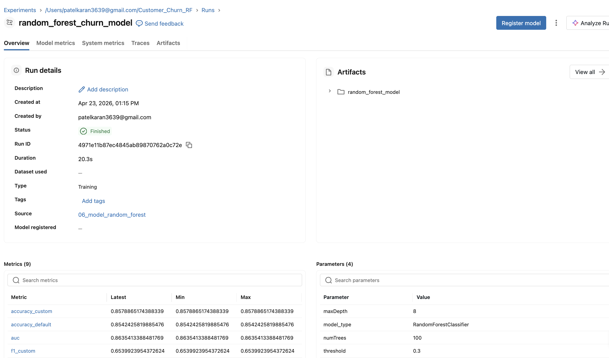

# Customer Churn Analytics on Databricks

An end-to-end customer churn project built on **Databricks**: data cleaning, feature engineering, Spark SQL analysis, machine learning models tracked with **MLflow**, and an interactive **Databricks AI/BI dashboard** that flags high-risk customers and the revenue at stake.



---

## Business problem

Losing customers is expensive. This project answers three questions:

1. **Who is likely to churn?** Score every customer with a churn probability.
2. **How much is at risk?** Measure the account balance held by high-risk customers.
3. **Where should retention efforts go?** Break churn down by geography, product count and activity.

## Key results

| Metric | Value |
|---|---|
| Customers analyzed | **10,000** |
| High-risk customers | **687** (6.87%) |
| Total balance | **$765M** |
| High-risk balance | **$65M** |
| Revenue at risk | **8.43%** of total balance |

**Insights from the dashboard**

- **Risk segments:** 86.70% low risk, 6.43% medium risk, 6.87% high risk.
- **Geography:** Germany has the highest churn rate (~30%), compared with ~20% for Spain and France.
- **Product count:** Customers with 1 or 2 products make up most of the base (5.08K and 4.59K) and churn far less than customers with 3 or 4 products, whose churn rate rises sharply.
- **High-risk list:** The dashboard lists every high-risk customer with their balance, product count, activity status and churn probability (up to 99%), ready for a retention team to act on.

<!-- TODO: add 2–3 more insights from 03_business_analysis (e.g. age, activity, gender). -->

---

## Project workflow

```
Raw data ──► 01 Data quality & cleaning
          ──► 02 Feature engineering
          ──► 03 Business analysis + 04 Spark SQL analysis
          ──► 05 / 06 Model training (tracked in MLflow)
          ──► 07 Model comparison ──► churn_predictions table
          ──► SQL queries ──► Customer Churn Dashboard
```

## Repository structure

```
customer-churn-analytics/
├── customer-churn-databricks/
│   ├── 01_data_quality_and_cleaning.ipynb   # Null checks, duplicates, data types, cleaning
│   ├── 02_feature_engineering.ipynb         # Feature creation and encoding
│   ├── 03_business_analysis.ipynb           # Exploratory analysis of churn drivers
│   ├── 04_spark_sql_analysis.ipynb          # Analysis with Spark SQL
│   ├── 05_churn_model_production.ipynb      # Final model, scoring and predictions table
│   ├── 06_model_random_forest.ipynb         # Spark MLlib Random Forest, tracked in MLflow
│   └── 07_model_comparison.ipynb            # Model comparison and selection
├── 01_KPI_churn.sql                         # Dashboard KPIs
├── 02_risk_distribution.sql                 # Low / medium / high risk split
├── 03_geography_churn.sql                   # Churn rate by country
├── 04_product_churn.sql                     # Churn rate by number of products
├── 05_high_risk_customers.sql               # High-risk customer list
├── 06_revenue_at_risk.sql                   # Balance held by high-risk customers
├── Customer Churn Dashboard.lvdash.json     # Databricks AI/BI dashboard
├── images/                                  # Screenshots used in this README
└── README.md
```

## Tech stack

| Area | Tools |
|---|---|
| Platform | Databricks (Free Edition), Unity Catalog |
| Data processing | PySpark, Spark SQL |
| Machine learning | Spark MLlib (Random Forest) |
| Experiment tracking | MLflow |
| Visualization | Databricks AI/BI Dashboards |
| Version control | Databricks Git folders + GitHub |

---

## Dataset

<!-- TODO: confirm the source. Example: "Bank Customer Churn dataset (Kaggle), 10,000 bank customers." -->

Each row is a bank customer. Main fields include customer ID, geography (France, Germany, Spain), account balance, number of products, active-member status and the churn label.

The model's output is stored in `workspace.default.churn_predictions`, which adds:

- `churn_probability`: predicted probability that the customer will churn
- `risk_flag`: 1 if the customer is classified as high risk
- `risk_segment`: Low / Medium / High risk

## Machine learning

The churn model is a **Spark MLlib `RandomForestClassifier`** trained in `06_model_random_forest`.

**Hyperparameters**

| Parameter | Value |
|---|---|
| `numTrees` | 100 |
| `maxDepth` | 8 |
| Decision threshold | 0.3 (custom) vs 0.5 (default) |

**Results on the test set**

| Metric | Default threshold (0.5) | Custom threshold (0.3) |
|---|---|---|
| Accuracy | 85.4% | **85.8%** |
| F1 score | <!-- TODO: f1_default --> | **0.654** |
| ROC-AUC | 0.864 | 0.864 |

Churners are the minority class, so a standard 0.5 cut-off misses many of them. Lowering the decision threshold to **0.3** flags more at-risk customers and raised accuracy from 85.4% to 85.8%. The model's ROC-AUC of **0.864** shows it separates churners from non-churners well. AUC doesn't depend on the threshold, so it's the same in both columns.

<!-- TODO: add precision / recall from the remaining MLflow metrics, and the comparison from 07_model_comparison -->

### MLflow experiment tracking

The training run is logged to the `Customer_Churn_RF` MLflow experiment with its parameters, metrics and the trained model artifact (`random_forest_model`), so every run can be compared and reproduced.



---

## Dashboard

The **Customer Churn Dashboard** is built from the SQL queries in this repo and includes:

- **KPI cards:** total customers, high-risk customers, total balance, revenue at risk (%) and high-risk balance
- **Risk distribution:** donut chart of low / medium / high risk customers
- **Churn by geography:** churn rate per country
- **Churn by product:** churn rate and customer count by number of products
- **High-risk customer table:** customers ranked by churn probability
- **Global filters:** geography and risk segment


## Future improvements

- Try gradient-boosted models (XGBoost / LightGBM) and tune hyperparameters
- Register the best model in the MLflow Model Registry and schedule batch scoring as a Databricks Job
- Add SHAP explanations for why each customer is high risk

---

## Author

**Karan Patel**
<!-- TODO: add your LinkedIn / portfolio link -->
